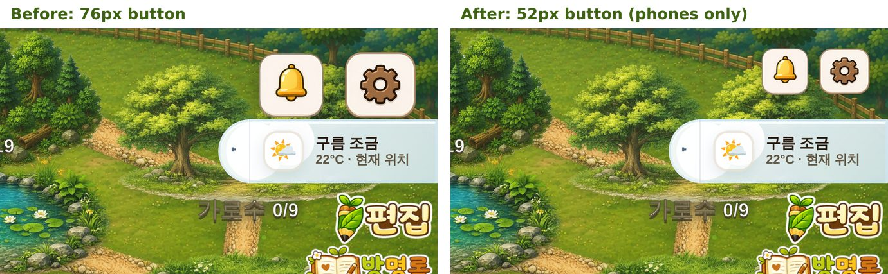

# 007. 폰에서 알림·설정 아이콘 줄이기

- 날짜: 2026-10-19
- 분류: 개선
- 계기
  - 사용자 요청: "알람 로고랑 환경설정 로고가 핸드폰에서 보면 좀 크다. 배경을 해치지 않을 정도로 조정해 달라."
  - [006](006-game-scene-transitions.md)을 main에 합치기 직전에 함께 처리했다.
- 관련 커밋: `5ee7518` style(ui): shrink the alarm and settings icons on phones

## 1. 배경

목장 오른쪽 위의 알림(종)·설정(톱니) 아이콘을 여러 화면 크기에서 쟀다(Playwright, Chromium).

| 화면 | 버튼 크기 | 화면 높이 대비 |
|---|---|---|
| 폰 가로 (667×375 ~ 932×430) | 76×76px | **18~21%** |
| 태블릿·PC (1133×744 ~ 1440×900) | 76×76px | 8~10% |

- 크기를 정하는 CSS 규칙이 `src/index.css`에 화면 크기 조건 없이 여러 번 덮어쓰여 있었다. 그래서 폰에서도 PC와 같은 76px이었다.
- 폰에서 보이는 타일(크림색 사각형)은 약 57px이었다. 왼쪽 위 프로필 카드(높이 52px)보다 컸고, 오른쪽 위 나무와 울타리를 가렸다.
- 그림 파일 안의 실제 타일 비율이 두 아이콘에서 달랐다.
  - 알림 그림: 200×200 캔버스 안에 타일이 156×155px(약 78%)이고 둘레는 투명하다.
  - 설정 그림: 200×185 캔버스를 타일이 거의 꽉 채운다.
  - 그래서 그림 크기를 같게 두면 두 타일 크기가 달라 보인다. 기존 코드도 알림 72.8px, 설정 62px로 따로 맞춰 두었다.

## 2. 검토한 선택지와 결정

보이는 타일 높이를 36·40·44px로 줄인 세 후보를 실제 화면에 입혀 4개 폰 크기에서 찍었다. 같은 스크린샷과 수치를 서로 다른 관점의 심사 3명(AI)에게 따로 보여 주고 고르게 했다.

| 후보 | 누르는 영역 | 장점 | 단점 |
|---|---|---|---|
| 36px | 47px | 배경이 가장 많이 보인다 | 작은 폰에서 톱니 모양이 뭉개진다. 큰 폰에서는 프로필 카드·편집 버튼 옆에서 너무 작아 보인다 |
| **40px** ✅ | 52px | 지금보다 약 30% 작다. 누르는 영역 52px이 프로필 카드 높이(52px)와 같아 위쪽 줄이 가지런하다 | 아이콘 안 그림(종·톱니)이 약 20px로 작아진다 |
| 44px | 57px | 가장 무난하다 | 작은 폰에서는 여전히 무거워 보여 "좀 크다"를 반만 해결한다 |

**결정: 40px.** 심사 3명(아이의 사용성, 화면 균형, 반박 관점) 모두 40px을 1순위로 골랐다.
- 폰에서만 바꾼다. 조건은 폰 가로(높이 500px 이하)와 폰 세로(폭 600px 이하)다.
  - 폰 가로 조건은 tailwind `short`와 같다. 그래서 높이 500px 이하로 줄인 PC 브라우저 창도 작은 아이콘이 된다. 그 크기에서는 프로필 카드 등 다른 UI도 이미 폰 모양으로 바뀌므로 일관된다.
  - 폰 세로 조건은 처음에 500px로 잡았다. 검토에서 앱의 회전 안내(`RotateDeviceOverlay`)가 쓰는 폰 세로 기준(600px)과 다르다는 지적을 받고 600px로 맞췄다.
- 태블릿·PC는 그대로 둔다. 사용자가 말한 것은 폰 화면이었고, 큰 화면에서는 이미 화면 높이의 8~10%라 적당하다.
- 기능 화면 위쪽 헤더(`AppHeader`: 도감·상점 등)도 같은 아이콘 클래스를 쓴다. 폰에서는 헤더 아이콘도 함께 작아진다. 일관되고, 헤더가 낮아져 내용이 더 보인다.

## 3. 구현

`src/index.css`의 기존 아이콘 규칙들 바로 뒤에 폰 전용 미디어 쿼리 하나를 더했다. 앞쪽 규칙들은 건드리지 않았다.

- 버튼(누르는 영역): 52×52px
- 그림 크기: 두 타일이 모두 40px 높이로 보이도록 그림 속 타일 비율로 나눴다.
  - 알림 그림: 40 ÷ 0.775 = 51.6px
  - 설정 그림: 40 ÷ 0.925 = 43.2px
- 알림 그림에는 `max-width: none`을 줬다. 기본 스타일 `img { max-width: 100% }`가 그림을 버튼 폭으로 줄여, 알림 타일만 작아지던 것을 처음 시도에서 발견했다.
- 버튼은 알림 그림(51.6px)이 들어가는 52px로 정했다. 버튼이 그림보다 작으면 그림이 버튼 위쪽에 붙어, 알림 타일이 설정 타일보다 약 2px 아래로 보였다.
- 알림 그림 파일(`public/ui/alarm-icon-sq.png`)의 잡티를 지웠다.
  - 타일 바깥 투명 여백에 반투명 픽셀 1,627개가 세로줄 모양으로 남아 있었다(알파 최대 138/255).
  - 밝은 도감 헤더에서 종 양옆에 희미한 점선으로 보였다(수정 전에도 있었다).
  - 타일 영역(가로 21~178, 세로 22~179px) 밖만 완전히 투명하게 했다. 타일 안쪽 픽셀은 하나도 바꾸지 않았다(비교 결과 0개). 파일은 22.4KB에서 21.1KB가 됐다.

## 4. 검증

Playwright(Chromium)로 수정 후 빌드에서 기기 크기 17가지(폰 가로 7, 폰 세로 2, 세로 경계 확인용 4, 태블릿 2, PC 2)를 쟀다. 수정 전 빌드는 같은 스크립트로 12가지를 쟀다.
그 뒤 독립 검토 2건(AI)을 따로 돌렸다.
- CSS 우선순위: 이 클래스의 규칙 66곳을 모두 읽고 확인했다. 새 규칙을 덮어쓰는 규칙은 없었고, hover·탭 팝 연출도 그대로 동작했다.
- 기기 24종 추가: 접는 폰 바깥·안쪽 화면, Z Flip, 1세대 SE, iPad 분할 화면, 짧은 노트북 창 등을 확인했다. 겹침·잘림 회귀는 없었다.
  - 오히려 폭 280~320px 세로 화면에서 원래 화면 밖으로 잘리던 설정 아이콘이 이제 화면 안에 들어온다.

| 확인 | 수정 전 | 수정 후 |
|---|---|---|
| 폰 가로 7종: 버튼 / 보이는 타일 높이 | 76px / 약 57px | 52px / 40px(알림 40.2×40, 설정 42.8×39.5) |
| 폰 가로: 아이콘 줄이 차지하는 화면 높이 | 18~21% | 12~14% |
| 두 타일 위 선 차이 | 약 0.7px | 0.1px |
| 태블릿·PC 4종 | 76px | 76px(그대로) |
| 도감 헤더 높이(852×393) | 101px | 77px |
| 도감 헤더 높이(667×375, 두 줄로 접힘) | 157px | 133px |
| 폰 세로 브라우저 탭(393×852·412×915) 목장 | 76px | 52px, 알림·설정과 다른 UI의 겹침 없음 |
| 세로 경계: 540×720·600×960 / 601×962·744×1133 | 76px | 52px / 76px(그대로) |

- 손가락 탭 확인(852×393, 667×375): 알림을 누르면 공지 창이 열리고, 설정을 누르면 `/profile/edit`로 간다. 콘솔 오류는 0건이었다.
- 튜토리얼 전체 흐름(첫 주소 `/` → 회원가입 → 10단계)을 다시 돌렸다. 모든 단계가 1씩 넘어갔고 오류는 0건이었다.
- 두 버튼 사이(보이는 간격 약 10px)를 누르면 설정 쪽으로 잡힌다. 버튼에는 앞쪽 규칙의 `border-radius: 999px`가 남아 있어 누르는 영역은 지름 52px 원이다. 보이는 타일은 모서리 끝 1px 미만을 빼면 이 원 안에 들어간다(수정 전에도 원 모양이었다).

## 5. 한계와 남은 일

- [ ] **실기기 확인**: 아이 손가락으로 두 아이콘을 헷갈리지 않고 누르는지 실제 폰에서 본다. 이번 확인은 Chromium 흉내다.
- [ ] 높이 500px를 넘는 가로 화면(예: Surface Duo 720×540)과 접는 폰을 펼친 화면은 태블릿처럼 76px로 남는다. 사용 기기를 보고 조건을 조정한다.
- [ ] `src/index.css`에는 같은 아이콘 규칙이 화면 크기 조건 없이 10번 넘게 덮어쓰여 있다(파일 뒤쪽 사본 포함). 이번에는 맨 뒤에 폰 규칙만 더했다. 중복 블록 정리는 따로 한다.

## 6. 포트폴리오 포인트

- "좀 크다"는 느낌을 화면 높이 대비 비율(18~21%)과 그림 파일 속 실제 타일 비율로 바꿔, 정량적인 목표(보이는 타일 40px)로 만들었다.
- 후보 셋을 실제 화면에 입혀 비교하고, 서로 다른 관점의 심사로 골랐다.
- 그림 파일마다 다른 투명 여백을 계산에 넣어 두 아이콘이 같은 크기·같은 줄로 보이게 했다.
